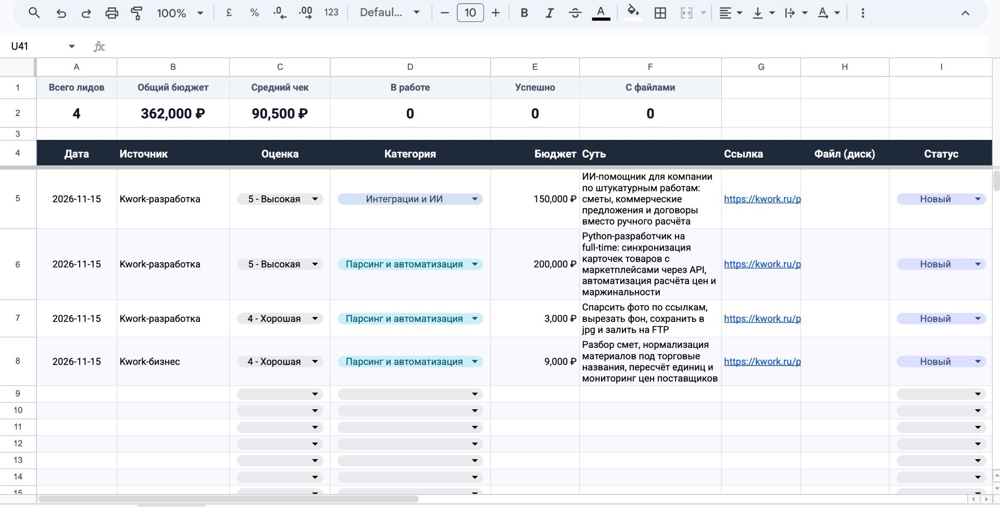
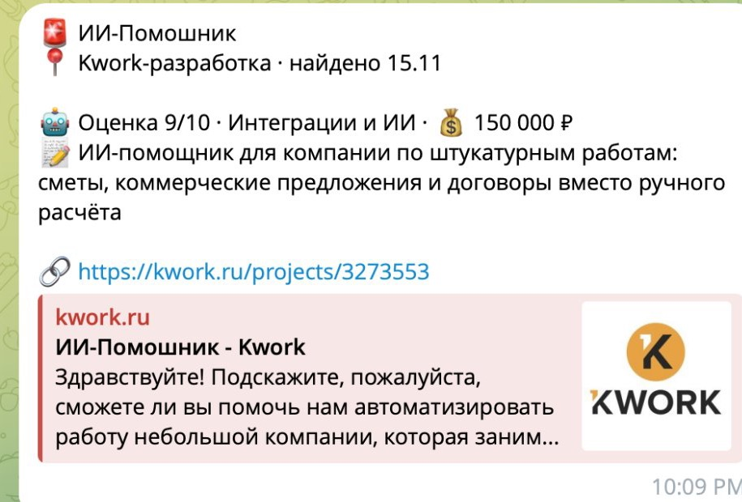
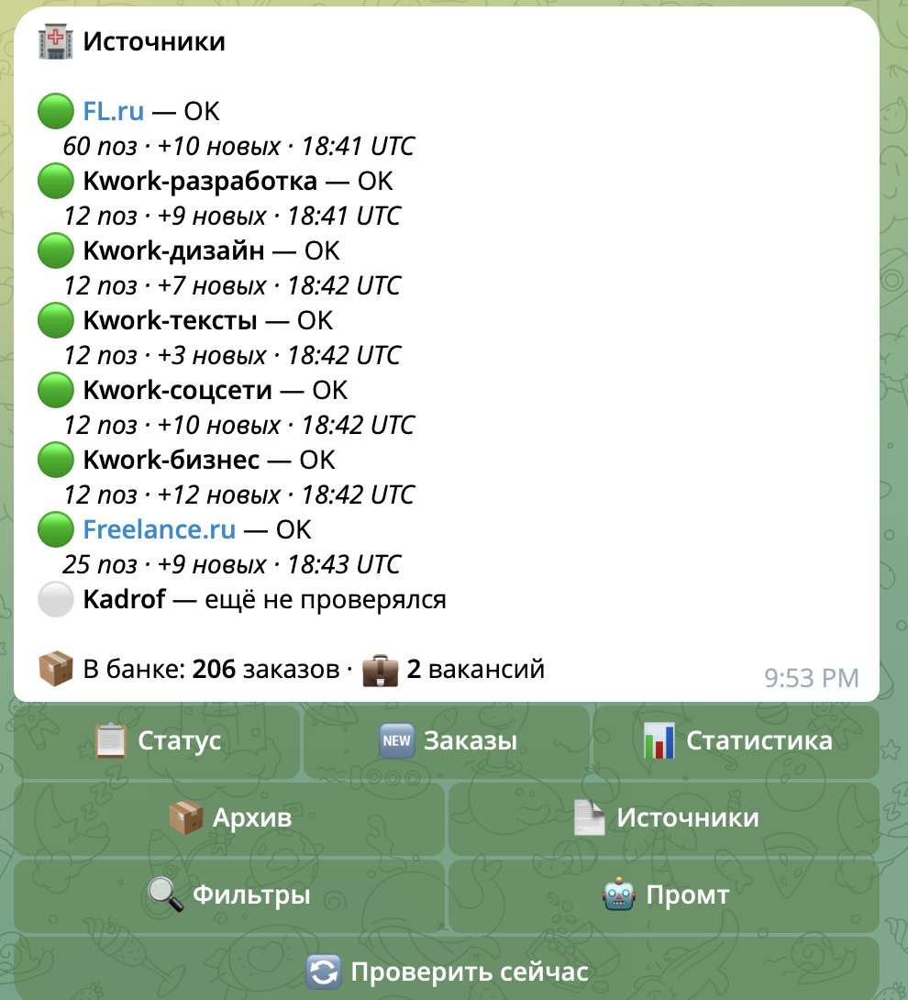
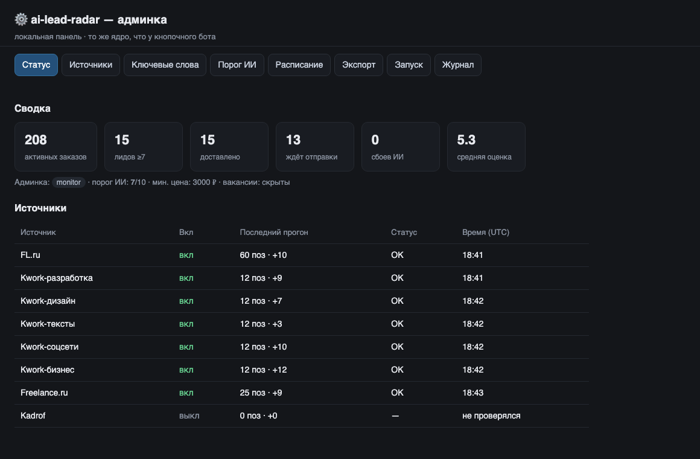

# AI Lead Radar — сбор, отбор и выгрузка данных с помощью ИИ

Пайплайн для бизнеса: собирает входящие данные из веб-источников, отсеивает шум
**до** обращения к нейросети, оценивает и структурирует подходящее через ИИ, а потом
доставляет готовые карточки в **Telegram**, **Google Таблицу** и **CSV**.

В демо подключены биржи заказов — открытый источник, на котором видно работу системы.
Архитектура разложена на независимые модули: источник заменяется под мониторинг
конкурентов, прайс-листов, тендеров, вакансий или входящих заявок, а остальной
конвейер остаётся тем же.

---

## Как это выглядит в работе



<table>
<tr>
<td></td>
<td></td>
</tr>
<tr>
<td align="center"><i>Карточка лида: суть, ссылка, превью заказа</i></td>
<td align="center"><i>Панель управления: разделы, настройки, запуск</i></td>
</tr>
<tr>
<td colspan="2" align="center"></td>
</tr>
<tr>
<td colspan="2" align="center"><i>Веб-панель: сводка по банку и здоровье источников</i></td>
</tr>
</table>

---

## Что умеет система

### 1. Сбор данных без дублей и лишнего шума

* Подключается к нескольким источникам одновременно (RSS и HTML-страницы) и хранит
  историю в локальной базе: одна и та же запись не приходит дважды.
* **Отсев до нейросети.** Ключевые слова со стеммингом и стоп-слова отбрасывают
  заведомо неподходящее ещё до вызова модели. Это не косметика: каждый вызов модели
  стоит денег и времени, а на бесплатном тарифе — ещё и лимита.

### 2. Квалификация и структурирование через ИИ

* **Оценка 0–10 и порог отбора.** Модель оценивает каждую позицию по заданным
  критериям, дальше проходит только то, что выше порога. Порог меняется кнопкой,
  без правки кода. В самой системе шкала 0–10, а в Google Таблице та же оценка
  показывается подписью 1–5: 9–10 → «5 - Высокая», 8 → «4 - Хорошая»,
  7 → «3 - Средняя» — чтобы колонка была выпадающим списком, а не числом.
* **Суть вместо простыни.** Вместо исходного текста на экран и в таблицу попадает
  одна строка: что нужно сделать, почему позиция отобрана и какой бюджет.
* **Восемь категорий, а не свободный текст.** Записи раскладываются по фиксированному
  перечню, поэтому колонка «Категория» в таблице становится выпадающим списком и
  сводной, а не свалкой из десятков формулировок.
* **Два режима подключения модели:** локальный CLI (бесплатная модель, 0 ₽) и любой
  OpenAI-совместимый HTTP-шлюз. Переключается строкой в настройках, код не правится.

### 3. Готовые каналы доставки

* **Google Таблица в реальном времени.** Строки уходят через собственный вебхук
  Google Apps Script с проверкой токена. В таблице считаются итоги: сколько лидов,
  суммарный бюджет, средний чек, статусы работы.
* **Telegram.** Карточка с оценкой, категорией, бюджетом, сутью и ссылкой. Отметка
  «доставлено» ставится только после ответа Telegram; если сеть моргнула — карточка
  возвращается в очередь и уходит на следующем цикле, а не теряется.
* **Excel / CSV.** Файл с разделителем `;` и меткой кодировки: открывается в Excel
  без кракозябр.

### 4. Управление без программиста

Обе панели работают на одном ядре настроек, поэтому не могут показывать разные числа.

* **В Telegram:** включение и отключение источников, ключевые слова, порог отбора,
  минимальная цена, редактирование промта для модели и ручной запуск проверки —
  кнопками в одном сообщении.
* **В браузере:** локальная веб-панель на восемь экранов — статус, источники, слова,
  порог, расписание, экспорт, запуск, журнал. Расписание задаётся пресетами
  (выключить / час / 6 часов / сутки), а не вводом числа часов.

---

## Какие задачи бизнеса это закрывает

* **Продажи и агентства.** Сбор профильных заявок и лидов с площадок с автоотбором
  по чеку и тематике — вместо ручного просмотра лент.
* **E-commerce и закупки.** Регулярный мониторинг карточек и цен конкурентов или
  поставщиков со сводкой изменений в Google Таблице.
* **Аналитика и HR.** Первичный отбор вакансий, тендеров и упоминаний с автоматической
  классификацией: на выходе таблица, а не список ссылок.

---

## Результаты контрольного прогона

Один прогон на семи активных источниках: бесплатная модель, настоящая сеть.

| Что | Число |
|---|---|
| Позиций скачано со всех источников | **145** |
| Прошли фильтр по словам и ушли к модели | **25** (потолок на цикл) |
| Среднее время одного вызова модели | **8,1 с** |
| Прошли порог оценки | **11** |
| Дублей в базе | **0** |

Что это значит на практике: из 25 случайных заказов с бирж **11 оказались
профильными** (боты, парсинг, интеграции с API), а 14 — рерайт, инвайтинг,
«заполнение карточек». Отсев делает модель, а не человек: просмотр 25 позиций стоит
около трёх минут машинного времени и ноль внимания сотрудника.

---

<details>
<summary><b>Техническая часть: архитектура, безопасность, тесты, запуск</b></summary>

### Стек

Только стандартная библиотека Python 3.9+ (`sqlite3`, `http.server`, `urllib`, `xml`,
`json`). Ни одной внешней библиотеки, ни Docker, ни сервера базы: SQLite лежит файлом
рядом. Отсутствие зависимостей проверяется автоматическим AST-тестом, а не обещанием.

### Безопасность

* **Защита от инъекций во входящем тексте.** Модель вызывается в свежем пустом
  временном каталоге, аргументами списком без shell, с запретом инструментов записи
  и выполнения. Проверено пробой: промт «создай файл» не создал ни одного файла.
* **Вебхук таблицы** закрыт токеном: адрес вебхука — это право писать в таблицу,
  поэтому токен сверяется на каждой строке.
* **Секреты** (токен бота, ключи модели, токен таблицы) живут только в локальном
  файле настроек с правами `600` и не попадают в репозиторий.
* **Стоп-кран:** после трёх отказов модели подряд цикл останавливается, а не долбит
  шлюз. Служебные теги рассуждений модели вырезаются перед показом.

### Надёжность

`python3 app/test_monitor.py` → **395/395**, код возврата 0. Тест обязан уметь падать:
это проверено тремя намеренными поломками в отдельной копии — снятая обрезка оценки,
снятая очистка служебных тегов и снятая проверка токена вебхука дают красный результат.

### Структура

```
configs/monitor.json   источники, слова, порог, расписание
app/monitor.py         цикл: сбор → фильтр → оценка → доставка
app/sources.py         разбор лент и страниц
app/storage.py         база: заказы, прогоны, оценки
app/llm_filter.py      вызов модели, разбор ответа
app/budget.py          правило бюджета — одно на чат и таблицу
app/categories.py      восемь категорий и приведение к канону
app/sheet_webhook.py   отправка строк в Google Таблицу
app/admin_core.py      общее ядро настроек и статистики
app/bot.py             панель в Telegram
app/admin_web.py       локальная веб-панель
docs/TABLITSA.md       подключение Google Таблицы, с экранами разрешений
```

### Запуск

```bash
cd app
cp ../.env.example .env        # вписать токен бота, chat id и настройки модели
python3 monitor.py --dry-run   # что нашлось, ничего не сохраняя
python3 monitor.py             # рабочий цикл
python3 bot.py                 # панель в Telegram
python3 admin_web.py           # вторая панель: http://127.0.0.1:8765
```

### Ограничения, о которых честно

* Тендерные площадки и часть бирж не подключены: открытого RSS у них нет, это были бы
  новые парсеры, а не строка конфигурации.
* Telegram-каналы как источник не используются: правила платформы запрещают сбор
  данных из неё, в том числе для ИИ.
* Веб-панель рассчитана на одного человека на своей машине: пароля у неё нет.
* Режим HTTP-шлюза проверен на локальном стенде (ответы 200/401/429/таймаут), с живым
  платным ключом не запускался. Рабочий режим демо — локальный CLI с бесплатной моделью.
* Бесплатная модель живёт на дневных лимитах: когда они кончаются, вызов не отвечает,
  и это видно командой `python3 monitor.py --check-llm` — она печатает причину словами.

</details>

## Лицензия

MIT — см. `LICENSE`. Что взято идеей, а что написано здесь — см. `NOTICE`.
